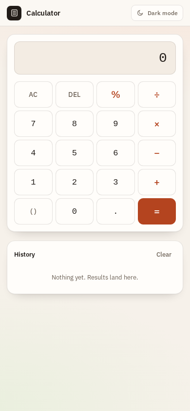
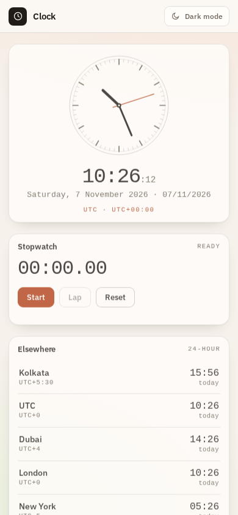
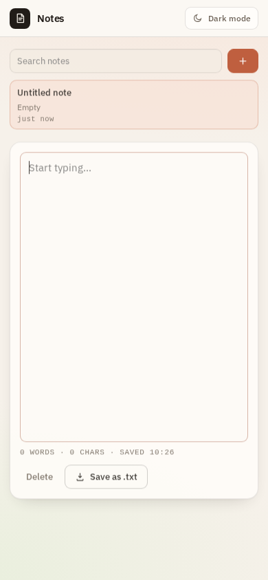
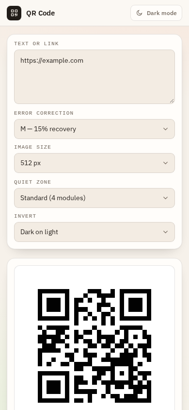
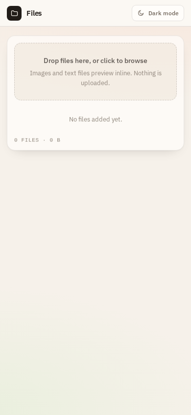

# Toolkit for Android — five tiny offline apps

Five separate apps, one shared design, zero network access. Each APK is a
thin native shell around a single self-contained HTML page, so every build
lands around 115 KB and runs without a connection — no INTERNET permission is
requested at all.

| App | Package | What it does |
| --- | --- | --- |
| **Calculator** | `dev.toolkit.calculator` | Expression parser with brackets, `%`, `^`, live result and a saved history |
| **Clock** | `dev.toolkit.clock` | Analog + digital local time, six world clocks, stopwatch with laps, countdown timer with a beep |
| **Notes** | `dev.toolkit.notes` | Autosaving scratchpad stored in the WebView's local storage, search, export to `.txt` |
| **QR Code** | `dev.toolkit.qr` | QR generator written from scratch in the page (byte mode, versions 1–40, ECC L/M/Q/H), PNG export |
| **Files** | `dev.toolkit.files` | Drop or pick local files to see size, type, image/text preview — nothing leaves the device |

All five support light and dark themes, follow the system setting on first
run, and remember your choice.

<p align="center">
  
  
  
</p>
<p align="center">
  
  
</p>

## Install

Download the APK you want from [`apk/`](apk/) and open it on the phone
(allow "install unknown apps" for your browser or file manager the first
time). Android 8.0 (API 26) or newer.

```
apk/calculator-1.0.0.apk
apk/clock-1.0.0.apk
apk/notes-1.0.0.apk
apk/qr-1.0.0.apk
apk/files-1.0.0.apk
```

These builds are signed with a debug key, which is fine for sideloading but
not for the Play Store. For a release build, generate your own key with
`keytool` and pass it through `KEYSTORE` (see `tools/build_app.py`).

## Layout

```
apps/<name>/            one app: manifest, resources, app.json, assets/index.html
shared/src/             MainActivity.java, shared by every app
tools/build_app.py      aapt2 -> ecj -> d8 -> zipalign -> apksigner
tools/fetch-deps.sh     downloads ecj, creates the debug keystore
build.sh                builds every app into dist/
apk/                    the signed APKs committed for download
```

Each app differs only in its `app.json`, resources (name, icon, colours) and
the bundled `assets/index.html`. The Java is shared.

## Build it yourself

No Gradle, no Android Studio project — just the real SDK tools:

```bash
export JAVA_HOME=/path/to/jdk-17+
export ANDROID_HOME=/path/to/android-sdk     # needs build-tools;34.0.0 and platforms;android-34
./tools/fetch-deps.sh                        # ecj.jar + debug.keystore
./build.sh                                   # all five
./build.sh qr                                # or just one
```

Output lands in `dist/`. `aapt2` compiles the resources, `ecj` compiles
`MainActivity.java` against `android.jar`, `d8` produces `classes.dex`,
`zipalign` fixes alignment and `apksigner` signs the result.

The same steps run on every push in
[`.github/workflows/build-apks.yml`](.github/workflows/build-apks.yml), which
uploads the APKs as artifacts and attaches them to a release when you push a
`v*` tag.

## How the shell works

`MainActivity` creates a `WebView`, enables JavaScript and DOM storage, turns
off Chrome's force-dark (the page has its own theme), and loads
`file:///android_asset/index.html`. Two small bridges keep it native-feeling:

- `Android.isDark()` lets the page follow the system theme before first paint.
- `Android.setTheme(mode)` is called by a `MutationObserver` whenever the page
  flips its theme, so the status and navigation bars follow along.

Links to other schemes are handed to the system browser; nothing else can
leave the app.

## Licence

MIT — see [LICENSE](LICENSE).
